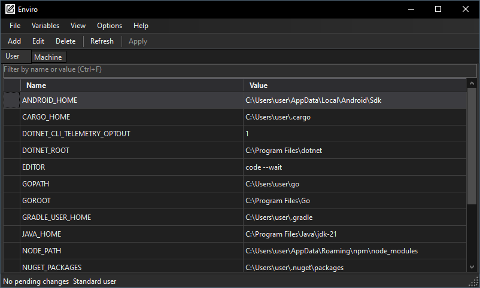

# Enviro
[]()
[]()
[](https://www.gnu.org/licenses/gpl-3.0)

A lightweight environment variable manager for Windows with a classic interface.



## Why does this exist?

Windows has a built-in environment variable editor, but its interface is outdated and error-prone: values are edited as opaque strings, there is no change tracking to show what was modified, deleted or created, and mistakes are hard to notice and undo.

Enviro addresses this with a classic Windows interface, change tracking for every user and system variable, and a staged apply — nothing is written until you confirm it.

## Features

- 🎯 **Native WinForms**: Built with Windows Forms for a smaller binary size & performance.
- 📋 **Change Tracking**: See exactly what was modified, deleted, or created in your environment variables.
- ✅ **Path Validation**: Detects variables pointing to invalid/non-existent paths.
- 💾 **Import/Export**: Back up and restore your environment variables to a JSON file, choosing exactly which variables travel.
- 🌓 **Theme Support**: Follows the Windows light/dark mode, with a System/Light/Dark choice in Options that applies on the next start.
- ⚡ **Instant Apply**: Changes take effect immediately without system restart.

## Requirements

- Windows 10 or later
- .NET 10
- Administrator privileges (only for system variable modifications)

## Usage

1. Launch Enviro
2. Edit user variables, or provide admin credentials for system variables
3. Review changes before applying — the view will show all modifications
4. Apply changes

## Installation

### Windows

1. Download the latest release from the [Releases](https://github.com/regularentropy/enviro/releases) page
2. Extract the archive and run `Enviro.exe`
3. No additional dependencies required

For system-wide variable editing, run as administrator or allow elevation when prompted.

## Contributing
Pull requests are welcome. For major changes, open an issue first to discuss what you want to change.

Build requirements:
- Visual Studio 2026 or later
- .NET 10 SDK

From source:

```shell
git clone https://github.com/regularentropy/enviro.git
cd enviro
dotnet run --project src/enviro/enviro.csproj
```

Self-contained single-file build:

```shell
dotnet publish enviro.slnx --configuration Release --output ./publish/win-x64 --runtime win-x64 --self-contained true /p:PublishSingleFile=true
```

## Used Assets
- Logo: https://www.svgrepo.com/svg/532995/pen-square

## License

[GPLv3](LICENSE) ©2025 regularentropy